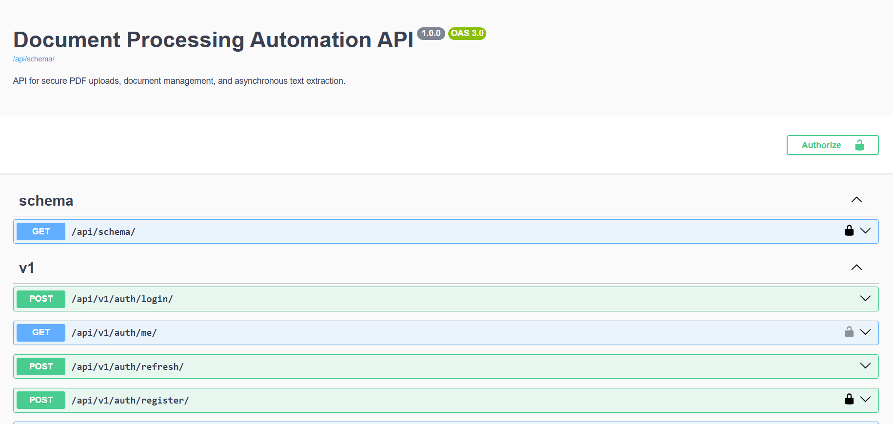

# Document Processing Automation API

A production-deployed backend API built with **Django REST Framework** that allows authenticated users to upload PDF documents, process them asynchronously, and retrieve extracted text.

The project demonstrates REST API development, JWT authentication, document validation, background task processing, cloud file storage, automated testing, Docker-based development, and production deployment.

## Live Demo

- **Live API & Swagger UI:** https://document-processing-automation-api.onrender.com/api/doc/
- **OpenAPI Schema:** https://document-processing-automation-api.onrender.com/api/schema/
- **ReDoc:** https://document-processing-automation-api.onrender.com/api/redoc/

## Project Screenshot



## Features

- **JWT Authentication** — user registration, login, token refresh, and authenticated user endpoints.
- **Document Management** — upload, list, retrieve, and delete PDF documents.
- **Document Validation** — validate PDF uploads and enforce a 10 MB file-size limit.
- **User Data Isolation** — users can access and manage only their own documents.
- **Asynchronous Processing** — process documents in the background using Celery and Redis.
- **PDF Text Extraction** — extract text from PDF files using PyMuPDF.
- **Extracted Text Retrieval** — retrieve extracted PDF text through a dedicated endpoint.
- **Processing Status Tracking** — track documents through uploaded, pending, processing, completed, and failed states.
- **Task Reliability** — retry failed processing tasks and prevent duplicate processing.
- **Private Cloud Storage** — store production PDF documents in AWS S3.
- **Automated Tests** — test authentication, document management, validation, and processing behavior.
- **Code Coverage** — 94% overall coverage across the application and configuration.
- **Docker Support** — run the API, PostgreSQL, Redis, and Celery worker using Docker Compose.
- **Production Configuration** — Gunicorn, WhiteNoise, Supervisor, environment-based settings, and security configuration.
- **Structured JSON Logging** — capture document-processing events, errors, retries, and contextual metadata for production troubleshooting.

## Tech Stack

| Technology | Purpose |
|---|---|
| Python | Backend programming |
| Django | Web framework |
| Django REST Framework | REST API development |
| PostgreSQL | Relational database |
| Redis | Celery message broker and result backend |
| Celery | Background task processing |
| PyMuPDF | PDF text extraction |
| SimpleJWT | API authentication |
| AWS S3 | Private document storage |
| Docker & Docker Compose | Containerization and local service orchestration |
| Gunicorn | WSGI application server |
| Supervisor | Web and worker process management |
| WhiteNoise | Static file serving |
| pytest | Automated testing |
| pytest-django | Django test integration |
| pytest-cov | Code coverage reporting |
| python-json-logger | Structured JSON logging |
| drf-spectacular | OpenAPI documentation |

## Architecture

```text
                   Client / API Consumer
                            |
                            v
                  Django REST Framework
                            |
             +--------------+--------------+
             |              |              |
             v              v              v
         PostgreSQL       AWS S3          Redis
         User and       Private PDF      Celery
        document        file storage    message broker
        metadata                            |
                                            v
                                      Celery Worker
                                            |
                                            v
                                         PyMuPDF
                                            |
                                            v
                                    Extract PDF text
                                            |
                                            v
                                 Update document status
                                 and extracted text
```

The API stores document metadata in PostgreSQL and PDF files in the configured storage backend.

Local development uses Django filesystem storage, while production uses a private AWS S3 bucket.

After an upload, the API schedules asynchronous processing through Celery and Redis. The Celery worker retrieves the PDF, extracts its text using PyMuPDF, and updates the document's processing status and extracted text in PostgreSQL.

## API Endpoints

All endpoints use the `/api/v1/` prefix.

### Authentication

| Method | Endpoint | Description |
|---|---|---|
| POST | `/api/v1/auth/register/` | Register a new user |
| POST | `/api/v1/auth/login/` | Obtain JWT access and refresh tokens |
| POST | `/api/v1/auth/refresh/` | Refresh an access token |
| GET | `/api/v1/auth/me/` | Retrieve the authenticated user's profile |

### Documents

| Method | Endpoint | Description |
|---|---|---|
| POST | `/api/v1/documents/` | Upload a PDF document |
| GET | `/api/v1/documents/` | List the authenticated user's documents |
| GET | `/api/v1/documents/<id>/` | Retrieve a document |
| GET | `/api/v1/documents/<id>/text/` | Retrieve extracted text after successful processing |
| DELETE | `/api/v1/documents/<id>/delete/` | Delete a document and its stored file |

### Authentication

Document endpoints require a valid JWT access token. Include it in the request header:

```http
Authorization: Bearer <access_token>
```

Users can access and manage only their own documents. PDF uploads are validated before processing, and document text extraction runs asynchronously through Celery.

## Interactive API Documentation

The API documentation is generated using `drf-spectacular` and the OpenAPI specification.

| Resource | Local URL | Purpose |
|---|---|---|
| Swagger UI | `http://localhost:8000/api/doc/` | Explore endpoints and execute API requests |
| OpenAPI Schema | `http://localhost:8000/api/schema/` | View or retrieve the API specification |
| ReDoc | `http://localhost:8000/api/redoc/` | Browse API documentation in ReDoc |

### Using Swagger UI

1. Start the application using Docker Compose.
2. Open the Swagger UI URL in your browser.
3. Expand an endpoint to inspect its request parameters, request body, and responses.
4. Use **Try it out** to execute requests.
5. Register a user or log in to obtain JWT tokens.
6. Click **Authorize** and provide your access token using the format `Bearer <access_token>`.
7. Test authenticated endpoints, including document uploads and document retrieval.

For PDF uploads, select `multipart/form-data` and use the file picker to choose a PDF file.

## Document Processing Lifecycle

Documents move through the following statuses:

| Status | Description |
|---|---|
| `UPLOADED` | The document has been uploaded. |
| `PENDING` | Processing has been scheduled. |
| `PROCESSING` | A worker is processing the document. |
| `COMPLETED` | Processing finished successfully. |
| `FAILED` | Processing failed after an error. |

PDF text extraction runs asynchronously, allowing the API to respond without waiting for the entire processing task to finish.

Failed tasks can be retried, and completed or already-processing documents are protected against duplicate processing.

## Run Locally with Docker

### Prerequisites

- Docker Desktop
- Git

### 1. Clone the repository

```bash
git clone https://github.com/prachisharma-py/document-processing-automation-api.git
cd document-processing-automation-api
```

### 2. Configure environment variables

Create your local `.env` file from the example:

```bash
cp .env.example .env
```

Update the values in `.env`, especially the Django secret key and database password.

Keep `.env` private and never commit real secrets.

### 3. Start the services

```bash
docker compose up --build -d
```

Check service status:

```bash
docker compose ps
```

View application logs:

```bash
docker compose logs -f web
```

View Celery worker logs:

```bash
docker compose logs -f celery
```

### 4. Run database migrations

```bash
docker compose exec web python manage.py migrate
```

### 5. Create an administrator (optional)

```bash
docker compose exec web python manage.py createsuperuser
```

The API documentation will be available at:

`http://localhost:8000/api/doc/`

## Run Tests

Development and testing dependencies are maintained separately in `requirements-dev.txt`, keeping them separate from production dependencies.

Install the development dependencies in your Python virtual environment:

```bash
pip install -r requirements-dev.txt
```

Run the automated test suite:

```bash
pytest
```

Run tests with code coverage:

```bash
pytest --cov=apps --cov=config --cov-report=term
```

Run Django's configuration check:

```bash
python manage.py check
```

### Test Results

<text>27 automated tests passed</text>

<text>94% overall code coverage</text>

The test suite covers authentication, document management, upload validation, and asynchronous document-processing behavior.

## Configuration

The `.env.example` file documents the environment variables required by the application, including:

- Django secret key, debug mode, and allowed hosts.
- PostgreSQL database name, username, password, host, and port.
- Redis connection URL.
- Celery broker and result backend URLs.
- AWS S3 bucket name and region for production document storage.
- AWS credentials supplied securely through the deployment environment or an IAM role.

For local development, leave `AWS_STORAGE_BUCKET_NAME` unset to use filesystem storage.

For production, configure the AWS S3 bucket and region, along with appropriate AWS credentials or IAM permissions.

Never commit real credentials or secret keys.

## Project Structure

```text
document-processing-automation-api/
├── apps/
│   ├── users/
│   └── documents/
├── config/
├── Dockerfile
├── docker-compose.yml
├── supervisord.conf
├── .dockerignore
├── .env.example
├── .gitignore
├── manage.py
├── pytest.ini
├── requirements.txt
└── requirements-dev.txt
```

## Production Deployment

The application is deployed on **Render** with PostgreSQL and Redis, while AWS S3 provides private document storage.

The production setup uses:

- Docker for application containerization.
- PostgreSQL for persistent relational data.
- Redis for Celery task messaging and results.
- Celery for asynchronous document processing.
- Gunicorn to serve the Django application.
- Supervisor to manage the web and Celery worker processes.
- Environment variables for production configuration.
- AWS S3 for private PDF storage.
- Structured JSON logging for document-processing events, errors, retries, and operational troubleshooting.

### Live Production Resources

| Resource | URL |
|---|---|
| Swagger UI | https://document-processing-automation-api.onrender.com/api/doc/ |
| OpenAPI Schema | https://document-processing-automation-api.onrender.com/api/schema/ |
| ReDoc | https://document-processing-automation-api.onrender.com/api/redoc/ |

### Try the Live API

1. Open the Swagger UI.
2. Register a new user using the registration endpoint.
3. Log in to obtain JWT access and refresh tokens.
4. Click **Authorize** and enter your access token.
5. Test the authenticated document endpoints.

**Note:** The Render free web service may take some time to respond after a period of inactivity. Background processing runs alongside the web application, so queued tasks may be delayed while the service is inactive.

## Current Project Status

The core API and production deployment are implemented.

- JWT authentication and user-specific document access.
- PDF upload, validation, listing, retrieval, and deletion.
- Private AWS S3 storage for production documents.
- Asynchronous PDF processing using Celery and Redis.
- PDF text extraction using PyMuPDF.
- Document processing status tracking, retries, and duplicate-processing protection.
- Dedicated endpoint for retrieving extracted text.
- Docker-based local development environment.
- Automated test suite with 93% overall coverage.
- Production deployment on Render with PostgreSQL, Redis, Gunicorn, and Supervisor.
- GitHub Actions CI workflow for automated checks and test execution.
- Structured JSON logging for production document-processing events and errors.

The production API supports the complete document-processing workflow, from PDF upload to extracted-text retrieval.

## Future Improvements

- Add document processing metrics and performance monitoring.
- Add support for additional document formats.
- Improve API rate limiting and abuse protection.

## Contributing

Contributions, suggestions, and improvements are welcome.

To contribute:

1. Fork the repository.
2. Clone your fork:

   ```bash
   git clone https://github.com/<your-username>/document-processing-automation-api.git
   ```

3. Create a feature branch:

   ```bash
   git checkout -b feature/your-feature-name
   ```

4. Install development dependencies and configure your local environment using `.env.example` and `requirements-dev.txt`.
5. Make your changes and add appropriate tests.
6. Run the automated test suite:

   ```bash
   pytest
   ```

7. Commit and push your changes:

   ```bash
   git add .
   git commit -m "Describe your changes"
   git push origin feature/your-feature-name
   ```

8. Open a Pull Request describing your changes.

Please ensure that tests pass and that no credentials, secret keys, or environment-specific configuration files are committed.
